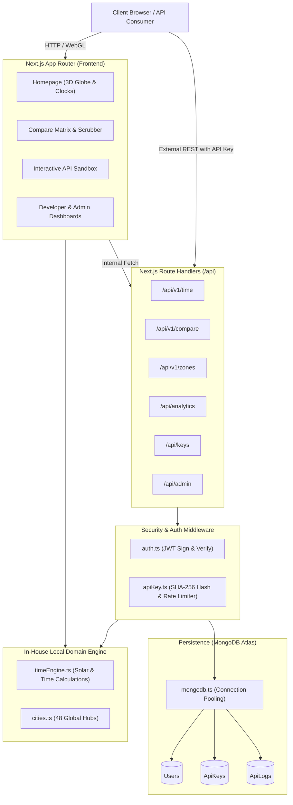

# 🌍 TimeOrbit

[](https://nextjs.org/)
[](https://react.dev/)
[](https://www.typescriptlang.org/)
[](https://tailwindcss.com/)
[](https://www.mongodb.com/)
[](./tests)
[](./LICENSE)

**TimeOrbit** is an open-source, interactive 3D WebGL global timezone explorer and developer platform. It combines real-time astronomical solar calculations, a multi-city time comparison matrix with working-hours overlap detection, and a high-throughput developer REST API backed by SHA-256 API key authentication, rolling-window rate limiting, and real-time telemetry analytics.

---

## 📑 Table of Contents

- [Overview & Value Proposition](#-overview--value-proposition)
- [Key Features](#-key-features)
- [Architecture & Request Lifecycle](#-architecture--request-lifecycle)
- [Tech Stack](#-tech-stack)
- [Getting Started](#-getting-started)
  - [Prerequisites](#prerequisites)
  - [Installation & Setup](#installation--setup)
  - [Environment Variables](#environment-variables)
  - [Auto-Seeded Super Admin](#auto-seeded-super-admin)
- [REST API Reference](#-rest-api-reference)
  - [1. Location Time (`GET /api/v1/time`)](#1-location-time-get-apiv1time)
  - [2. Timezone Comparison (`GET /api/v1/compare`)](#2-timezone-comparison-get-apiv1compare)
  - [3. Supported Zones (`GET /api/v1/zones`)](#3-supported-zones-get-apiv1zones)
  - [4. Usage Analytics (`GET /api/analytics`)](#4-usage-analytics-get-apianalytics)
- [Developer Dashboard & Key Management](#-developer-dashboard--key-management)
- [Testing & Quality Assurance](#-testing--quality-assurance)
- [Project Directory Layout](#-project-directory-layout)
- [License](#-license)

---

## 🌟 Overview & Value Proposition

Coordinating across global time zones introduces subtle pitfalls: Daylight Saving Time shifts, fractional offsets (such as India's `UTC+05:30` or Nepal's `UTC+05:45`), and date roll-overs (+1 or -1 day). Existing services are often locked behind paid tiers, enforce restrictive rate limits, or suffer from latency.

**TimeOrbit** solves this with an **in-house computational engine** (`src/lib/timeEngine.ts`):
- **Zero External Runtime API Dependencies**: All timezone conversions, solar elevation angles, daylight calculations, and overlap matrices execute locally in sub-millisecond compute time.
- **Interactive Visual Scrubber**: Instant visual detection of mutual working hours across continents.
- **Developer-First Infrastructure**: Self-service API keys, rolling 60-second rate limiting, in-browser sandbox playground, and real-time usage telemetry.

---

## 🚀 Key Features

### 🌐 Full-Page Interactive 3D Three.js Celestial Stage
- Custom **Three.js WebGL Celestial Engine** (`GlobeCanvas.tsx`) rendering an immersive 100vh full-page space environment.
- **Dynamic Day/Night Shading**: Real-time solar terminator separating daytime illumination from the dark hemisphere.
- **Night City Lights & Lat/Lng Grid**: Realistic illuminated nocturnal city clusters and coordinate grid lines on Earth's dark side.
- **2,000-Star Deep Space Field**: Procedural starfield with depth and realistic starlight ambiance.
- **Live Sun & Moon In Space**:
  - 3D Sun positioned at calculated real-time subsolar zenith coordinates with solar flare corona.
  - 3D Moon orbiting on a dashed trajectory ring, with live sublunar position and lunar phase illumination (0–100%).
- **Geodesic Flight Arc**: 3D curved trajectory arc physically connecting Location A and Location B across Earth's surface.
- **Shortest-Path Camera Gliding**: Normalized angle interpolation (`((((lng - current) % 360) + 540) % 360) - 180`) for smooth transitions without wild multi-turn spinning.
- **Continuous Auto-Rotation**: Frictionless, continuous orbital rotation with zoom controls (`+` / `-`) and mouse-wheel support.

### 🏙️ 48 Global Metropolitan Hubs & GPS Geolocation
- Expanded catalog of **48 world cities** categorized across 6 continental regions (Asia & South Asia, Europe, North America, Latin America, Oceania & Pacific, Africa).
- **One-Click GPS Auto-Detection**: Instant geolocation via `navigator.geolocation` with automatic fallback to nearest timezone metropolitan hub.
- **Instant City Switching & Swap (⇄)**: Seamlessly toggle or swap primary and secondary focus from the Left Celestial Menu, Floating Clocks Dock, or directory cards.

### ⏱️ Synchronized Dual Clocks & 24-Hour Working Overlap Matrix
- Floating dual clock cards with digital time, UTC offset, timezone abbreviations, and live coordinates.
- **Synchronized Column Grid Dock**: Dedicated column alignment for Location A and Location B dropdowns with styled custom chevron indicators.
- **24-Hour Scrubber**: Interactive slider to simulate any time of day and visualize cross-continental working overlaps (09:00 - 18:00) with fractional offsets (`+05:30`, `+05:45`) and cross-day boundary indicators (`+1 Day`, `-1 Day`).

### 🔭 Slide-Out Celestial Observatory Panel
- Real-time astronomical telemetry deck displaying Sun & Moon altitude, azimuth, solar noon, dawn/dusk twilight times, and exact coordinates.

### 🔑 Developer REST API & Sandbox (`/docs`)
- Dedicated REST API (`/api/v1/*`) with standard JSON envelopes and HTTP status codes.
- Interactive in-browser API testing sandbox with real-time response previews and copyable code snippets (curl, JavaScript/TypeScript, Python).
- Built-in rate limiting headers (`x-ratelimit-limit`, `x-ratelimit-remaining`, `x-ratelimit-reset`).

### 📊 Real-Time Analytics Telemetry (`/dashboard` & `/admin`)
- User-level telemetry on `/dashboard` (request volumes, average latencies, status distributions, endpoint breakdown).
- Global telemetry on `/admin` for administrators with API key review, approval, and revocation controls.
- Dual-mode authentication support (JWT session cookie or API key header) with role-based scoping (`me` vs `global`).

### 🛡️ Enterprise-Grade Security
- Cryptographic SHA-256 API key hashing (`to_live_...` prefix; plaintext keys are never persisted).
- Rolling 60-second window rate limiting via MongoDB aggregation.
- Passwords hashed with `bcryptjs` (salt rounds: 12) and sessions secured via HTTP-only, SameSite JWT cookies.

---

## 🏛️ Architecture & Request Lifecycle



---

## 💻 Tech Stack

| Layer | Technology | Description |
|---|---|---|
| **Framework** | [Next.js 16](https://nextjs.org/) (App Router) | Server and Client Components, Edge/Node Route Handlers |
| **UI Library** | [React 19](https://react.dev/) | Modern concurrent UI architecture |
| **Language** | [TypeScript 5](https://www.typescriptlang.org/) | Strict static typing across domain, models, and routes |
| **Styling** | [Tailwind CSS v4](https://tailwindcss.com/) | Custom dark mode glassmorphic styling |
| **3D Graphics** | [Three.js](https://threejs.org/) (r183) & WebGL | Custom celestial observatory engine with Earth textures, stars, Moon orbit, and flight arcs |
| **Icons** | [Lucide React](https://lucide.dev/) | Clean, consistent SVG icon set |
| **Database** | [MongoDB](https://www.mongodb.com/) via [Mongoose 8](https://mongoosejs.com/) | Document persistence with pooled connections |
| **Security** | [jsonwebtoken](https://github.com/auth0/node-jsonwebtoken) & [bcryptjs](https://github.com/dcodeIO/bcrypt.js) | JWT session verification & salted password hashing |
| **Testing** | Node ESM / [Vitest](https://vitest.dev/) | 63 automated unit, integration, and scenario tests |

---

## 🛠️ Getting Started

### Prerequisites

- **Node.js**: `v18.18.0` or higher (Node 20+ recommended)
- **npm**: `v9.0.0` or higher
- **MongoDB**: An active MongoDB Atlas cluster URI or a local MongoDB instance

### Installation & Setup

1. **Clone the repository**:
   ```bash
   git clone https://github.com/Tech-Genkai/TimeOrbit.git
   cd TimeOrbit
   ```

2. **Install dependencies**:
   ```bash
   npm install
   ```

3. **Configure environment variables**:
   Create a `.env.local` file by copying the example:
   ```bash
   cp .env.example .env.local
   ```

4. **Run the development server**:
   ```bash
   npm run dev
   ```
   Open [http://localhost:3000](http://localhost:3000) in your browser.

5. **Build for production**:
   ```bash
   npm run build
   npm start
   ```

---

### Environment Variables

Configure `.env.local` with the following variables:

```ini
# MongoDB Atlas Connection URI
MONGODB_URI=mongodb+srv://<username>:<password>@cluster0.xxxxx.mongodb.net/timeorbit?retryWrites=true&w=majority

# JWT Authentication Secret (32+ character random string)
JWT_SECRET=your_jwt_secret_key_here

# Application Base URL
NEXT_PUBLIC_APP_URL=http://localhost:3000

# Super Admin Credentials (auto-seeded on first database connection)
ADMIN_EMAIL=admin@example.com
ADMIN_PASSWORD=change_this_admin_password
```

### Auto-Seeded Super Admin

When `connectToDatabase()` initializes, TimeOrbit inspects the database. If no user exists with `ADMIN_EMAIL`, it automatically provisions an account with the `admin` role and securely hashes `ADMIN_PASSWORD` using `bcryptjs`. You can immediately sign in at `/login` with these credentials to access the `/admin` portal.

---

## 📡 REST API Reference

All v1 endpoints support authentication via either the `x-api-key` header or the `Authorization: Bearer <key>` header.

### Rate Limiting Headers
Every response includes real-time rate limit telemetry:
- `x-ratelimit-limit`: Maximum allowed requests per 60-second window (default: `60`).
- `x-ratelimit-remaining`: Remaining request allowance in current window.
- `x-ratelimit-reset`: Seconds until quota window resets.

---

### 1. Location Time (`GET /api/v1/time`)

Retrieves current astronomical time, solar state, and UTC offset for a city.

**Query Parameters:**
- `location` (required): City name, ID, or timezone slug (e.g., `Tokyo`, `new_york`, `London`).

**Example Request:**
```bash
curl -X GET "http://localhost:3000/api/v1/time?location=Tokyo" \
  -H "x-api-key: to_live_your_api_key_here"
```

**Example Response (`200 OK`):**
```json
{
  "success": true,
  "data": {
    "city": "Tokyo",
    "country": "Japan",
    "timezone": "Asia/Tokyo",
    "flag": "🇯🇵",
    "coordinates": { "lat": 35.6762, "lng": 139.6503 },
    "time": {
      "iso": "2026-10-24T15:30:00.000+09:00",
      "formatted": "15:30:00",
      "hour24": 15,
      "minute": 30,
      "utcOffset": "+09:00",
      "utcOffsetMinutes": 540,
      "isDST": false
    },
    "solar": {
      "elevation": 14.2,
      "state": "day",
      "isDay": true
    }
  }
}
```

---

### 2. Timezone Comparison (`GET /api/v1/compare`)

Compares two cities, computes directional time differences, and generates a 24-hour comparative matrix.

**Query Parameters:**
- `from` (required): Source city ID or name (e.g., `Tokyo`).
- `to` (required): Target city ID or name (e.g., `London`).

**Example Request:**
```bash
curl -X GET "http://localhost:3000/api/v1/compare?from=Tokyo&to=London" \
  -H "x-api-key: to_live_your_api_key_here"
```

**Example Response (`200 OK`):**
```json
{
  "success": true,
  "data": {
    "from": {
      "city": "Tokyo",
      "timezone": "Asia/Tokyo",
      "time": "15:30",
      "solar": "day"
    },
    "to": {
      "city": "London",
      "timezone": "Europe/London",
      "time": "06:30",
      "solar": "dawn"
    },
    "difference": {
      "hours": -9,
      "formatted": "-9h 0m",
      "description": "London is 9 hours behind Tokyo"
    },
    "workingHoursOverlap": {
      "startUtc": 9,
      "endUtc": 10,
      "overlapHours": 1
    },
    "timeline": [
      { "hour": 9, "fromTime": "09:00", "toTime": "00:00", "isWorkingHour": false },
      { "hour": 15, "fromTime": "15:00", "toTime": "06:00", "isWorkingHour": false }
    ]
  }
}
```

---

### 3. Supported Zones (`GET /api/v1/zones`)

Returns the catalog of 38 pre-configured world cities, flags, coordinates, and timezone identifiers. **Public endpoint (no API key required).**

**Query Parameters:**
- `q` (optional): Filter cities by name, country, or timezone.

**Example Request:**
```bash
curl -X GET "http://localhost:3000/api/v1/zones?q=tokyo"
```

**Example Response (`200 OK`):**
```json
{
  "success": true,
  "count": 1,
  "data": [
    {
      "id": "tokyo",
      "name": "Tokyo",
      "country": "Japan",
      "countryCode": "JP",
      "timezone": "Asia/Tokyo",
      "lat": 35.6762,
      "lng": 139.6503,
      "flag": "🇯🇵"
    }
  ]
}
```

---

### 4. Usage Analytics (`GET /api/analytics`)

Returns aggregated API usage statistics, latency benchmarks, and endpoint breakdowns.

**Headers:**
- Cookie: `timeorbit_token=<jwt>` OR
- Header: `x-api-key: to_live_...`

**Query Parameters:**
- `scope`: `'me'` (default, scoped to user) or `'global'` (requires admin privileges).
- `range`: `'24h'` | `'7d'` | `'30d'` | `'all'` (default: `'7d'`).

**Example Response (`200 OK`):**
```json
{
  "success": true,
  "scope": "me",
  "range": "7d",
  "summary": {
    "totalRequests": 1420,
    "avgResponseTimeMs": 42.5,
    "minResponseTimeMs": 8,
    "maxResponseTimeMs": 310,
    "successRate": 99.2
  },
  "requestsOverTime": [
    { "date": "2026-10-20", "count": 210, "avgLatency": 40.1 },
    { "date": "2026-10-21", "count": 340, "avgLatency": 45.3 }
  ],
  "endpointBreakdown": [
    { "endpoint": "/api/v1/time", "count": 920, "percentage": 64.8 },
    { "endpoint": "/api/v1/compare", "count": 500, "percentage": 35.2 }
  ],
  "statusDistribution": [
    { "status": 200, "count": 1408, "percentage": 99.2 },
    { "status": 404, "count": 12, "percentage": 0.8 }
  ]
}
```

---

## 🔑 Developer Dashboard & Key Management

TimeOrbit provides a developer portal at `/dashboard` where authenticated users can:
1. **Provision API Keys**: Generate keys with the secure `to_live_` prefix.
2. **Key Security**: Keys are displayed only once upon generation; only SHA-256 digests are stored in the database.
3. **Usage Metrics**: View real-time request counts, latency distributions, and interactive SVG bar charts.
4. **Code Snippets**: Copy ready-to-use requests for curl, Node.js (`fetch`), and Python (`requests`).

---

## 🧪 Testing & Quality Assurance

TimeOrbit maintains an automated test suite executed via:

```bash
npm test
```

### Test Architecture

The test harness executes 63 deterministic tests across 4 coverage tiers without external database dependencies:

```
================================================================
GRAND TOTAL TEST SUMMARY: 63 PASSED, 0 FAILED
================================================================
```

| Suite | Focus Areas |
|---|---|
| **`timeEngine.test.mjs`** | UTC conversions, negative offsets, fractional offsets (`+05:30`), leap year (`2024-02-29`), midnight boundaries, solar elevations. |
| **`apiKey.test.mjs`** | `to_live_` key generation, SHA-256 hashing, status checks (`pending`, `approved`, `revoked`), rolling 60s rate limit enforcement. |
| **`endpoints.test.mjs`** | In-memory REST testing of `/api/v1/time`, `/api/v1/compare`, and `/api/v1/zones` with header validations. |
| **`analytics_empirical_challenge.mjs`** | Dual-mode auth validation, role scoping (`me` vs `global`), range validation (`24h`, `7d`, `30d`), CORS preflights, zero-division resilience. |
| **`adversarial_telemetry_stress.mjs`** | High-volume traffic simulation (100k requests), UI chart scaling, race-condition mitigation with `AbortController`. |

To run the linter:
```bash
npm run lint
```

---

## 📂 Project Directory Layout

```
TimeOrbit/
├── .env.example                     # Environment configuration template
├── PROJECT.md                       # Engineering milestones & technical specifications
├── TEST_INFRA.md                    # Test infrastructure and scenario matrices
├── package.json                     # Project manifest and scripts
├── src/
│   ├── app/
│   │   ├── page.tsx                 # Homepage with 3D globe & live city clocks
│   │   ├── compare/page.tsx         # Timezone comparison matrix & scrubber
│   │   ├── docs/page.tsx            # Interactive REST API sandbox & docs
│   │   ├── dashboard/page.tsx       # Developer key management & analytics
│   │   ├── admin/page.tsx           # Admin key approval & global telemetry
│   │   ├── login/page.tsx           # User authentication
│   │   ├── register/page.tsx        # User registration
│   │   └── api/
│   │       ├── v1/
│   │       │   ├── time/route.ts    # GET /api/v1/time
│   │       │   ├── compare/route.ts # GET /api/v1/compare
│   │       │   └── zones/route.ts   # GET /api/v1/zones
│   │       ├── analytics/route.ts   # GET /api/analytics
│   │       ├── keys/route.ts        # POST/GET/DELETE API key management
│   │       ├── auth/                # Login, register, logout handlers
│   │       └── admin/               # Admin review and key status endpoints
│   ├── components/
│   │   ├── globe/
│   │   │   └── GlobeCanvas.tsx      # Interactive 3D WebGL globe canvas
│   │   └── layout/
│   │       ├── Navbar.tsx           # Global navigation with active auth state
│   │       └── Footer.tsx           # Global footer
│   ├── lib/
│   │   ├── timeEngine.ts            # Solar & timezone computational engine
│   │   ├── cities.ts                # Catalog of 38 global cities and coordinates
│   │   ├── apiKey.ts                # SHA-256 key generator, validator & rate limiter
│   │   ├── auth.ts                  # JWT token signing & cookie verification
│   │   └── mongodb.ts               # Mongoose connection & admin auto-seeding
│   ├── models/
│   │   ├── User.ts                  # User schema with roles ('user' | 'admin')
│   │   ├── ApiKey.ts                # API key schema with hashed token
│   │   └── ApiLog.ts                # Request telemetry & rate limit window logs
│   └── types/
│       └── index.ts                 # Shared TypeScript interfaces
├── tests/                           # Automated test runner and suites
│   ├── run-all-tests.mjs            # Unified test harness
│   ├── timeEngine.test.mjs          # Core domain logic tests
│   ├── apiKey.test.mjs              # Security & rate limiting tests
│   ├── endpoints.test.mjs           # Route handler integration tests
│   ├── analytics_empirical_challenge.mjs
│   └── adversarial_telemetry_stress.mjs
└── public/                          # Static assets and favicons
```

---

## 📄 License

This project is licensed under the [MIT License](LICENSE).
