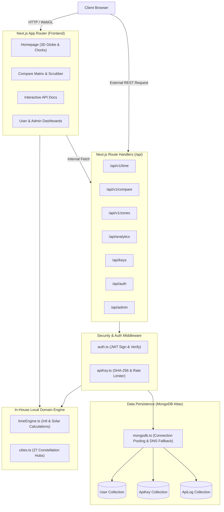
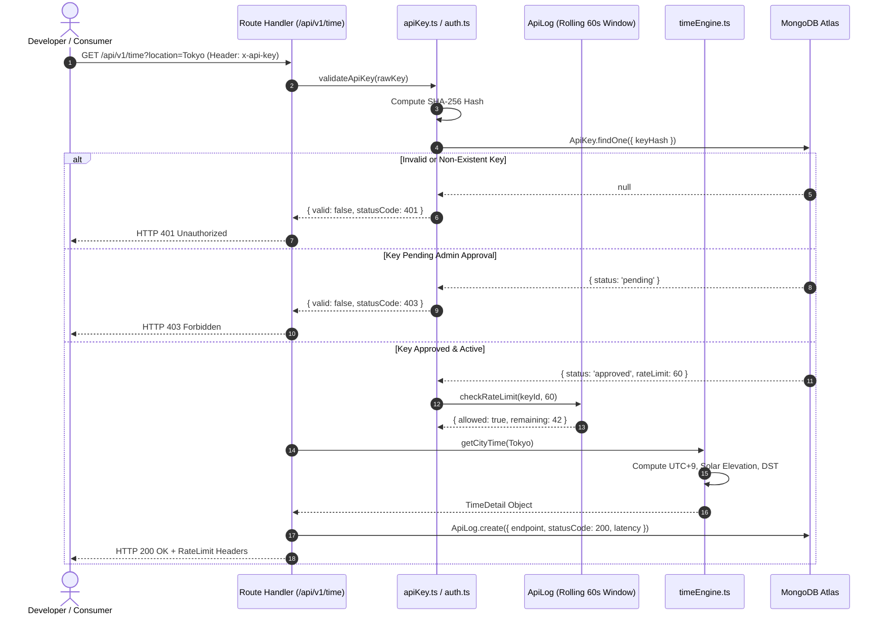

# System Architecture — TimeOrbit 🏛️

> **Overview**: Technical blueprint detailing TimeOrbit's full-stack architecture, request lifecycle, data flow, component hierarchy, and database design.

---

## 1. High-Level System Architecture

TimeOrbit is designed as a hybrid monolithic architecture leveraging Next.js App Router for server-rendered layouts, client-side interactive WebGL graphics, and modular REST route handlers.



---

## 2. Request Lifecycle & Authentication Flow

TimeOrbit implements a dual authentication architecture supporting both human web session cookies and machine API keys.



---

## 3. Component Hierarchy

```text
src/
├── app/
│   ├── layout.tsx                   # Root layout, ambient background, font definitions
│   │   ├── components/layout/Navbar.tsx  # Dynamic nav with live session state
│   │   └── components/layout/Footer.tsx  # Server-rendered semantic footer
│   ├── page.tsx                     # Landing page with 3D GlobeCanvas & quick search
│   ├── compare/page.tsx             # 24h timeline scrubber, city picker, overlap engine
│   ├── docs/page.tsx                # Interactive REST API tester & documentation
│   ├── dashboard/page.tsx           # Developer portal, key manager, usage charts
│   ├── admin/page.tsx               # Admin moderation panel, approval queue, global stats
│   ├── login/page.tsx               # JWT login form
│   ├── register/page.tsx            # User registration form
│   └── api/                         # 13 dynamic Next.js Route Handlers
├── components/
│   ├── globe/
│   │   └── GlobeCanvas.tsx          # WebGL sphere, cobe instance, marker rendering
│   └── layout/
│       ├── Navbar.tsx
│       └── Footer.tsx
├── lib/
│   ├── timeEngine.ts                # Astronomical & timezone calculations
│   ├── cities.ts                    # Curated dataset of 27 global cities
│   ├── apiKey.ts                    # SHA-256 key generation, validation, rate limiting
│   ├── auth.ts                      # JWT cookie management and session verification
│   └── mongodb.ts                   # Mongoose singleton connection with DNS resilience
└── models/
    ├── User.ts                      # User identity & roles
    ├── ApiKey.ts                    # API key hash, permissions & rate limits
    └── ApiLog.ts                    # Request telemetry & latency audit records
```

---

## 4. Astronomical Solar & Time Calculation Engine

The core domain logic in [`src/lib/timeEngine.ts`](file:///c:/Users/rajaa/Desktop/website/src/lib/timeEngine.ts) computes astronomical positions locally without relying on external web APIs:

1. **Day of the Year ($N$)**:
   $$\text{dayOfYear} = \lfloor \frac{\text{targetDate} - \text{Jan 1}}{86,400,000} \rfloor$$
2. **Solar Declination ($\delta$)**:
   $$\delta = 23.45^\circ \times \sin\left(\frac{360^\circ}{365} \times (N - 81)\right)$$
3. **Solar Time & Hour Angle ($H$)**:
   $$T_{\text{solar}} = \left(T_{\text{UTC}} + \frac{\text{Longitude}}{15^\circ} + 24\right) \pmod{24}$$
   $$H = (T_{\text{solar}} - 12) \times 15^\circ$$
4. **Solar Elevation Angle ($\alpha$)**:
   $$\sin(\alpha) = \sin(\text{Lat}) \sin(\delta) + \cos(\text{Lat}) \cos(\delta) \cos(H)$$
5. **Solar State Classification**:
   - $\alpha > 6^\circ \implies$ **Day**
   - $-6^\circ \le \alpha \le 6^\circ \implies$ **Dawn** ($T_{\text{solar}} < 12$) or **Dusk** ($T_{\text{solar}} \ge 12$)
   - $\alpha < -6^\circ \implies$ **Night**

---

## 5. Technology Stack Summary

| Layer | Technology | Justification |
|---|---|---|
| **Framework** | Next.js 16 (App Router) | Unified server rendering, client-side hydration, and dynamic route handlers. |
| **Language** | TypeScript 5 | Strict static typing, exhaustive type guards, and zero `any` domain models. |
| **Styling** | Tailwind CSS v4 | High-performance atomic styling, CSS variables, and modern glassmorphism. |
| **3D Rendering** | Cobe / WebGL | Ultra-lightweight (5KB) 60FPS canvas globe rendering without Three.js overhead. |
| **Database** | MongoDB Atlas (Mongoose 8) | Schema flexibility for logs, indexed hash lookups, and aggregation pipelines. |
| **Cryptography**| Native Node `crypto` & `bcryptjs` | SHA-256 for one-way API key hashing; bcrypt for credential salting. |
| **Testing** | Node.js ESM Test Runner | Zero-dependency, sub-second test execution across all 63 unit/stress suites. |
