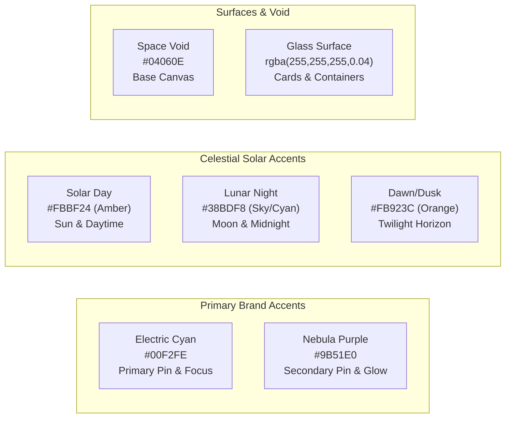

# Design System & UI/UX Philosophy — TimeOrbit 🎨

> **Theme**: Cosmic Cyberpunk & Deep Orbital Glassmorphism  
> **Philosophy**: Minimalist, high-contrast, informative, and visually immersive.

---

## 1. Visual Identity & Aesthetic Principles

TimeOrbit was designed to evoke the feeling of an orbital mission control station monitoring planetary time cycles.

1. **Deep Void Canvas**: The background is anchored in obsidian dark tones (`#04060e` and `#030712`), allowing vibrant neon accents to stand out with high contrast.
2. **Glassmorphism & Depth**: Surfaces utilize semi-transparent backdrops (`bg-white/5` or `bg-slate-900/60`) paired with subtle backdrop blur (`backdrop-blur-xl`) and hairline borders (`border-white/10`).
3. **Data-Dense Yet Clean**: Clocks, solar states, and timezone differences are presented using monospaced numerals, glowing status pills, and interactive micro-interactions.

---

## 2. Color Palette & Semantics



### Color Tokens
- **Primary Brand Neon**:
  - Cyan: `#00f2fe` / `rgb(0, 242, 254)` — Used for primary focus pins, brand titles, and active nav links.
  - Radiant Purple: `#a855f7` — Used for comparison secondary pins and subtle radiant gradients.
- **Solar Indicator Accents**:
  - Solar Day ☀️: `text-amber-400` / `#fbbf24`
  - Deep Night 🌙: `text-cyan-400` / `#22d3ee`
  - Dawn / Sunrise 🌅: `text-orange-400` / `#fb923c`
  - Dusk / Sunset 🌇: `text-rose-400` / `#fb7185`
- **Status Badges**:
  - Approved / Online: `text-emerald-400 bg-emerald-500/10 border-emerald-500/20`
  - Pending Review: `text-amber-400 bg-amber-500/10 border-amber-500/20`
  - Rejected / Revoked: `text-red-400 bg-red-500/10 border-red-500/20`

---

## 3. Typography & Hierarchy

- **Font Family**: Inter (System Sans fallback: `-apple-system, BlinkMacSystemFont, Segoe UI, Roboto`).
- **Numerals & Clocks**: `font-mono tracking-tight` for jitter-free clock ticking and numerical alignment.
- **Hierarchy**:
  - `Hero Display`: 48px – 64px (`text-4xl md:text-6xl font-extrabold tracking-tight`)
  - `Section Header`: 24px – 32px (`text-2xl font-bold text-white`)
  - `Card Header`: 16px – 18px (`text-base font-semibold text-gray-200`)
  - `Clock Display`: 28px – 36px (`text-2xl sm:text-3xl font-mono font-bold`)
  - `Caption & Meta`: 12px – 14px (`text-xs text-gray-400`)

---

## 4. 3D WebGL Globe Implementation

The 3D globe rendered by [`GlobeCanvas.tsx`](file:///c:/Users/rajaa/Desktop/website/src/components/globe/GlobeCanvas.tsx) is powered by **Cobe**:

```text
       ╭─────────────╮
    ╭──┤  3D SPHERE  ├──╮
   │   │  (WebGL)    │   │
  │    ╰─────────────╯    │
  │  ✦ Tokyo [Cyan]       │   <-- Primary Pinpoint (Size: 0.1)
  │      · London         │   <-- Constellation Node (Size: 0.028)
  │  ✦ New York [Purple]  │   <-- Secondary Pinpoint (Size: 0.085)
   │                      │
    ╰────────────────────╯
```

### Visual Specifications:
1. **Resolution & Sampling**: Canvas automatically scales with `devicePixelRatio` for razor-sharp rendering on Retina/4K displays.
2. **Constellation Pinpoints**:
   - Primary City Pin: Neon Cyan with pulsing radius.
   - Secondary City Pin: Purple with glow attenuation.
   - 25 Inactive Cities: Subtle blue constellation markers giving global geographical context.
3. **Smooth Camera Damping**:
   - Converting Latitude/Longitude to spherical angles ($\phi$, $\theta$).
   - Damped interpolation ($0.05$ spring delta per frame) to prevent abrupt visual jumps when switching selected cities.
4. **Drag & Auto-Rotation**:
   - Auto-rotates at constant low velocity when idle.
   - Allows users to freely drag and rotate the globe on mouse or touch gestures.

---

## 5. UI Components Showcase

### 5.1 Glassmorphism Card Style
```css
.glass-card {
  background: rgba(15, 23, 42, 0.6);
  backdrop-filter: blur(16px);
  border: 1px solid rgba(255, 255, 255, 0.08);
  box-shadow: 0 8px 32px 0 rgba(0, 0, 0, 0.37);
}
```

### 5.2 Glowing Button Action
```css
.glow-btn {
  background: linear-gradient(135deg, #06b6d4, #8b5cf6);
  box-shadow: 0 0 20px rgba(6, 182, 212, 0.35);
  transition: all 0.2s ease-in-out;
}
.glow-btn:hover {
  box-shadow: 0 0 28px rgba(139, 92, 246, 0.5);
  transform: translateY(-1px);
}
```

### 5.3 24-Hour Time Scrubber Matrix
- Horizontal 24-hour timeline displaying dual clock tracks.
- Cells within mutual working hours (9:00 AM – 6:00 PM) receive an emerald glow highlight (`border-emerald-500/40 bg-emerald-500/10`).
- Day boundary crossing points display bold `+1 Day` or `-1 Day` badges to eliminate remote meeting confusion.
