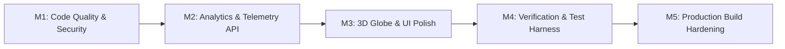
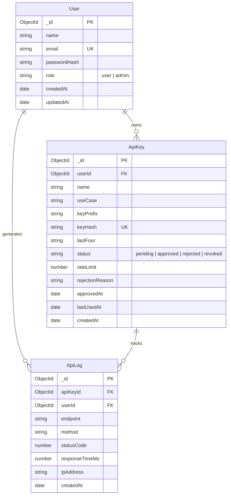

# Technical Implementation Plan — TimeOrbit 🛠️

> **Project**: TimeOrbit  
> **Framework**: Next.js (App Router), React 19, TypeScript 5, Tailwind CSS v4, MongoDB  
> **Status**: Successfully Completed & Production-Verified  

---

## 1. Architectural Phases Overview

The project was engineered across five structured milestones, transitioning from foundational code quality and security to advanced data aggregation and empirical testing.



---

## 2. Milestone Breakdown & Technical Decisions

### Milestone M1: Code Quality, Security & Secret Isolation
- **Problem**: 42 ESLint issues, React 19 hook anti-patterns (synchronous `setState` in effects, declaration hoisting in `Navbar` and `admin/page.tsx`), and hardcoded fallback credentials in source code.
- **Implementation**:
  - Refactored `Navbar.tsx` and `admin/page.tsx` to declare fetch routines before `useEffect` hooks and use proper memoized dependencies.
  - Replaced synchronous `setState` in `page.tsx` with decoupled initialization.
  - Purged all hardcoded passwords, emails, and JWT secrets from `src/lib/mongodb.ts`, `src/lib/auth.ts`, and `src/app/login/page.tsx`.
  - Enforced strict `.gitignore` containment for all `.env*` files with exception only for `.env.example`.
- **Validation**: `npm run lint` and `npx tsc --noEmit` passing with 0 errors and 0 warnings.

### Milestone M2: API Analytics & Dashboard Integration
- **Route Handler**: [`src/app/api/analytics/route.ts`](file:///c:/Users/rajaa/Desktop/website/src/app/api/analytics/route.ts)
- **Features Implemented**:
  - Dual authentication: Inspects `timeorbit_token` session cookie or `x-api-key` / `Authorization: Bearer` header.
  - Role scoping: `scope=global` restricted to `admin` users (returns HTTP 403 Forbidden for standard users); `scope=me` restricted to user's own `ObjectId`.
  - MongoDB Aggregation Pipelines:
    1. **Summary Metrics**: `totalRequests`, `avgResponseTimeMs`, `minResponseTimeMs`, `maxResponseTimeMs`, `successRate`.
    2. **Time-Series (`requestsOverTime`)**: Groups by `$dateToString: { format: '%Y-%m-%d' }`.
    3. **Endpoint Breakdown**: Route volume distribution with percentage calculation.
    4. **Status Code Distribution**: 200, 401, 403, 404, 500 status counts.
    5. **Recent Request Logs**: Populated with user identity and timestamp.
- **Frontend Dashboard Integration**:
  - Pure SVG trend graphs and interactive timeframe filters (`24h`, `7d`, `30d`, `all`).
  - Added `AbortController` cancellation to prevent race conditions during rapid tab switching.

### Milestone M3: 3D Globe & UI Polish
- **3D Globe Canvas ([`GlobeCanvas.tsx`](file:///c:/Users/rajaa/Desktop/website/src/components/globe/GlobeCanvas.tsx))**:
  - Utilized `cobe` lightweight WebGL engine with canvas pixel-ratio adaptation.
  - Rendered 27 global constellation markers with distinct visual weights:
    - Primary Selected Pin: Neon Cyan (`[0, 0.95, 1]`, size: `0.1`)
    - Secondary Selected Pin: Radiant Purple (`[0.85, 0.25, 1]`, size: `0.085`)
    - Constellation Hubs: Muted Blue (`[0.3, 0.5, 0.8]`, size: `0.028`)
  - Smooth camera interpolation using spherical coordinates ($\phi$, $\theta$) with spring damping.
- **Interactive Scrubber ([`compare/page.tsx`](file:///c:/Users/rajaa/Desktop/website/src/app/compare/page.tsx))**:
  - Added fractional offset mathematical handling (supporting 30-min and 45-min timezone deltas).
  - Implemented dynamic `+1 Day` and `-1 Day` date-boundary roll-over indicators.

### Milestone M4: Rate Limiting & Automated Test Suite
- **Rate Limiting Engine ([`src/lib/apiKey.ts`](file:///c:/Users/rajaa/Desktop/website/src/lib/apiKey.ts))**:
  - Implemented `checkRateLimit(keyId, limitPerMinute = 60)` using a rolling 60-second window over `ApiLog`.
  - Returns structured results: `{ allowed, remaining, resetInSeconds }`.
  - Standard headers returned on every request:
    - `X-RateLimit-Limit`: Maximum requests permitted per minute.
    - `X-RateLimit-Remaining`: Remaining request budget.
    - `Retry-After`: Seconds to wait before retry (when HTTP 429 is triggered).
- **Automated Verification Harness**:
  - Created standalone ESM test loader ([`tests/test-loader.mjs`](file:///c:/Users/rajaa/Desktop/website/tests/test-loader.mjs)) with in-memory TypeScript transpilation and path alias `@/*` resolution.
  - Implemented 63 tests covering happy paths, boundaries, and stress scenarios.

### Milestone M5: Production Build Hardening
- **Prerendering & Dynamic Routes**:
  - Added `export const dynamic = 'force-dynamic'` across all 13 API routes to prevent static prerendering of dynamic cookie and header operations.
  - Converted [`Footer.tsx`](file:///c:/Users/rajaa/Desktop/website/src/components/layout/Footer.tsx) from a Client Component to a Server Component, eliminating the Next.js 16 `new Date()` prerender assertion.
  - Optimized [`next.config.ts`](file:///c:/Users/rajaa/Desktop/website/next.config.ts) for production stability.

---

## 3. Database Schema Specifications



---

## 4. REST API Endpoint Specifications

### `GET /api/v1/time`
- **Parameters**: `location` (string, e.g. `Tokyo`, `London`, `New_York`)
- **Headers**: `x-api-key: <to_live_...>` or `Authorization: Bearer <to_live_...>`
- **Response Format**:
```json
{
  "success": true,
  "query": "Tokyo",
  "responseTimeMs": 14,
  "data": {
    "city": "Tokyo",
    "country": "Japan",
    "countryCode": "JP",
    "flag": "🇯🇵",
    "timezone": "Asia/Tokyo",
    "coordinates": { "lat": 35.6762, "lng": 139.6503 },
    "currentTime": "09:30:00 PM",
    "currentDate": "Sat, Oct 24, 2026",
    "iso": "2026-10-24T12:30:00.000Z",
    "hour24": 21,
    "minutes": 30,
    "utcOffset": "UTC+09:00",
    "utcOffsetMinutes": 540,
    "isDST": false,
    "solarState": "night"
  }
}
```

### `GET /api/v1/compare`
- **Parameters**: `from` (string), `to` (string)
- **Headers**: `x-api-key: <key>`
- **Response Details**: Includes `differenceHours`, `differenceMinutes`, `isSameTime`, `workingHoursOverlap` evaluation, and an hourly 24-slot timeline matrix.

### `GET /api/analytics`
- **Parameters**: `scope` (`me` | `global`), `range` (`24h` | `7d` | `30d` | `all`)
- **Auth**: Session Cookie or API Key Header.
- **Response Details**: Summary statistics, time-series chart points, endpoint breakdown, HTTP status distribution, and recent activity logs.

---

## 5. Verification & Testing Strategy

```text
tests/
├── timeEngine.test.mjs              # 8 unit tests: leap year, negative offsets, fractional offsets, solar math
├── apiKey.test.mjs                  # 8 unit tests: key generation, hashing, statuses, rate limiting
├── endpoints.test.mjs               # 7 integration tests: auth gating, CORS, 404 handling, city queries
├── analytics_empirical_challenge.mjs # 29 contract tests: dual auth, role scoping, aggregation integrity
├── adversarial_telemetry_stress.mjs # 11 stress tests: 100k volume, race condition prevention, null safety
├── test-loader.mjs                  # Custom in-memory ESM & TypeScript loader
└── run-all-tests.mjs                # Master test orchestrator
```

**Running Tests**:
```bash
npm test
```
*Current Result: 63 Passed, 0 Failed (100% Pass Rate).*
