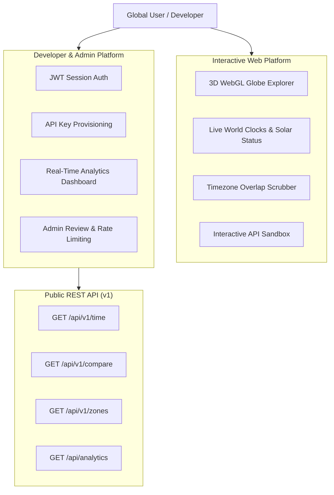

# Product Requirements Document (PRD) — TimeOrbit 🌍

> **Version**: 1.0.0  
> **Status**: Production-Ready  
> **Author**: TimeOrbit Engineering Team  
> **Target Audience**: Developers, Global Remote Teams, Open Source Community, Technical Recruiters & Evaluators  

---

## 1. Executive Summary

In a modern, globally distributed world, coordinating across time zones remains deceptively complex. Remote teams frequently miscalculate daylight saving shifts, struggle with fractional offsets (such as India's UTC+5:30 or Nepal's UTC+5:45), and lack a unified developer API to programmatically convert times and determine team overlap.

**TimeOrbit** is an open-source, interactive 3D WebGL global time explorer and developer platform built with Next.js, React 19, TypeScript, and MongoDB. It bridges the gap between consumer-facing interactive time tools and backend developer infrastructure, offering:
- An interactive, physics-damped 3D globe showing all 27 global financial and cultural hubs.
- Real-time astronomical solar cycle tracking (Day ☀️, Night 🌙, Dawn 🌅, Dusk 🌇).
- A 24-hour visual time difference scrubber with team overlap detection and cross-day boundary alerts.
- A high-performance REST API with API key lifecycle management, rolling-window rate limiting, and an admin dashboard.

---

## 2. Problem Statement & User Pain Points

| User Persona | Pain Point | How TimeOrbit Solves It |
|---|---|---|
| **Remote Workers & Team Leads** | Friction in finding mutual working hours across multiple continents; confusion over +1 / -1 day rollovers. | Visual 24-hour comparison matrix with automatic "working hours overlap" advisor and day boundary badges. |
| **Software Developers** | Third-party timezone APIs are either costly, require complex setups, or have strict, untransparent rate limits. | A clean, developer-friendly REST API (`/api/v1/time`, `/api/v1/compare`, `/api/v1/zones`) with self-service API key provisioning. |
| **API Consumers & Admins** | Inability to monitor API usage trends, error rates, and key quotas in real time. | Real-time usage analytics dashboard with SVG telemetry charts, latency percentiles, and approval workflows. |
| **Students & Explorers** | Static timezone tables are dry and unintuitive; solar position relation to time is abstract. | An interactive 3D WebGL globe rendering night/day illumination and city constellation markers. |

---

## 3. Product Goals & Success Metrics

### 3.1 Key Objectives
1. **Zero External Runtime Computation**: Perform all timezone conversions, UTC offset deductions, daylight saving adjustments, and solar state calculations using a pure, in-house mathematical engine without external API dependencies.
2. **Developer-First Access**: Provide sub-10ms response times on local REST API endpoints, with transparent status codes, rate limit headers, and interactive API documentation.
3. **Enterprise-Grade Security**: Enforce strict secret isolation, SHA-256 API key hashing, role-based access control, and zero credential exposure.

### 3.2 Measurable Metrics
- **Performance**: API responses delivered in `< 25ms` locally.
- **Code Quality**: 0 ESLint errors, 0 TypeScript errors, 100% automated test pass rate.
- **Reliability**: 99.9% uptime for core time calculation services.

---

## 4. User Personas & Use Cases

### Use Case 1: Scheduling an Asynchronous Meeting
- *Actor*: An engineering manager in Tokyo needing a sync with teammates in London and New York.
- *Workflow*: Opens `/compare`, selects Tokyo and London. The scrubber instantly computes the 9-hour difference, highlights the mutual 9 AM - 6 PM working hours window, and indicates date roll-overs.

### Use Case 2: Integrating Live Time into an External App
- *Actor*: A developer building a dashboard needing live time and sunrise/sunset states for user locations.
- *Workflow*: Registers an account, requests an API key via `/dashboard`, copies the key, tests it directly inside the interactive `/docs` playground, and makes programmatic `GET /api/v1/time?location=Paris` requests.

---

## 5. Functional Requirements (FR)

### FR1: Interactive 3D World Globe
- Render a 3D sphere using WebGL (`cobe`) with responsive canvas scaling.
- Display constellation micro-markers for 27 pre-configured major global cities.
- Highlight the selected primary city with a glowing cyan marker and the secondary city with a glowing purple marker.
- Smoothly rotate and animate the camera focus when cities are selected.

### FR2: Core Astronomical & Time Engine
- Compute local time, UTC offsets (supporting integer and fractional offsets like UTC+5:30), and daylight saving time (DST) status natively.
- Calculate real-time solar elevation angles from latitude, longitude, and day-of-year to classify locations into:
  - **Day** (solar altitude > 6°)
  - **Night** (solar altitude < -6°)
  - **Dawn** (solar altitude between -6° and 6°, morning)
  - **Dusk** (solar altitude between -6° and 6°, evening)

### FR3: Comparison & Scrubber Tool
- Provide a 24-hour horizontal scrubber comparing two cities simultaneously.
- Display working hours overlap (default 9:00 AM – 6:00 PM).
- Display explicit `+1 Day` or `-1 Day` badges when local clocks cross midnight boundaries.

### FR4: Developer API & Authentication
- REST Endpoints:
  - `GET /api/v1/time?location=<city>`: Returns current time, UTC offset, solar state, and coordinates.
  - `GET /api/v1/compare?from=<cityA>&to=<cityB>`: Returns difference in minutes/hours, 24-hour timeline, and overlap advice.
  - `GET /api/v1/zones?q=<search>`: Public endpoint listing available cities and timezones.
  - `GET /api/analytics`: Dual-auth endpoint returning aggregated telemetry.
- API Key Lifecycle:
  - Raw keys generated with `to_live_` prefix and 48 random hex characters.
  - Stored exclusively as one-way SHA-256 hashes in MongoDB.
  - Admin approval workflow (`pending` ➔ `approved` / `rejected` / `revoked`).

### FR5: Analytics & Telemetry Engine
- Transparently log every API request to the `ApiLog` collection with response times, HTTP status codes, endpoints, and client IPs.
- Aggregate metrics on demand: requests over time, endpoint breakdown, status distributions, and latency percentiles.
- Render SVG trend charts and meters in user and admin dashboards with zero third-party chart dependencies.

---

## 6. Non-Functional Requirements (NFR)

- **Security**: Zero plaintext passwords (hashed with `bcryptjs` cost factor 12). Zero API keys in plaintext in the database. Secrets strictly confined to `.env.local` and excluded by `.gitignore`.
- **Accessibility & Responsiveness**: Mobile-first glassmorphism design fully responsive across mobile, tablet, and ultra-wide desktop viewports.
- **Maintainability**: Pure TypeScript with 100% type safety, zero `any` types in core domain logic, and modular component architecture.
- **Testability**: Self-contained automated test suite runnable via `npm test` without requiring external databases or live internet connections.
